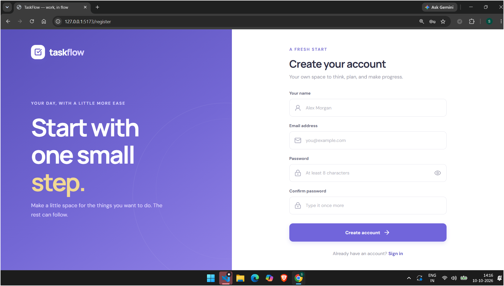
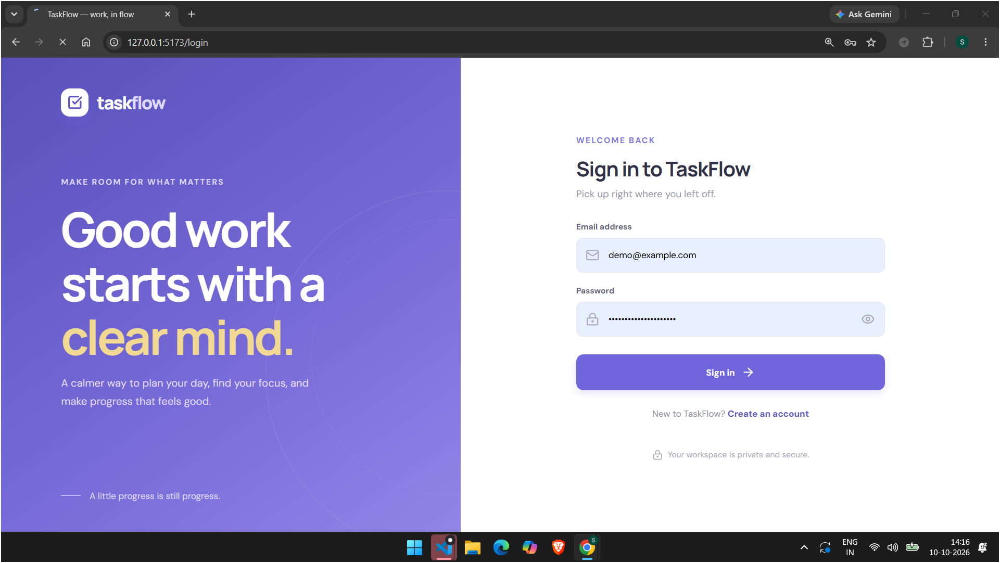

# TaskFlow — Work, in Flow

TaskFlow is a full-stack task management application built with **React, Vite, Node.js, Express, and MongoDB**. It provides a personal workspace to create and organize tasks, set priorities and due dates, track progress, and review a dashboard with task statistics.

## Screenshots

> Copy your screenshots into a `README_PHOTOS` folder in the repository and use these filenames.

### Sign In



### Login In


### Dashboard 1


### All Tasks


### Dashbord 2


### Dashbord 3


### Dashbord 4


## Features

- Register and sign in using email and password.
- Password hashing with `bcryptjs` and JWT-based authentication.
- Protected frontend routes and authenticated API endpoints.
- Create, view, edit, complete/reopen, and delete tasks.
- Search tasks by title or description.
- Filter tasks by status and priority.
- Sort and paginate task lists.
- Set task priorities and optional due dates.
- Dashboard statistics for total, pending, in-progress, completed, and overdue tasks.
- Recent-task list and completion percentage.
- Responsive interface with loading, empty, validation, and error states.
- API security with Helmet, CORS configuration, request validation, and centralized error handling.

## Tech Stack

**Frontend**
- React 18
- Vite
- React Router
- Axios
- lucide-react
- Responsive CSS

**Backend**
- Node.js 18+
- Express 4
- MongoDB and Mongoose
- JSON Web Tokens (JWT)
- bcryptjs
- dotenv
- cors
- express-validator
- Helmet
- Morgan

**Testing**
- Node.js built-in test runner
- API smoke/invariant tests
- Vite production build

## Project Structure

```text
TaskFlow/
├── backend/
│   ├── config/
│   │   └── db.js
│   ├── controllers/
│   ├── middleware/
│   ├── models/
│   ├── routes/
│   ├── Seed/
│   │   └── seed.js
│   ├── test/
│   │   └── server.test.js
│   ├── validators/
│   ├── utils/
│   │   └── asyncHandler.js
│   ├── .env.example
│   └── server.js
├── frontend/
│   ├── src/
│   │   ├── api/
│   │   ├── components/
│   │   ├── context/
│   │   ├── pages/
│   │   └── styles/
│   ├── .env.example
│   └── vite.config.js
├── .gitignore
└── package.json
```

## Prerequisites

Install the following before running the project:

- [Node.js 18 or later](https://nodejs.org/)
- npm (included with Node.js)
- [MongoDB Community Server](https://www.mongodb.com/try/download/community) or a MongoDB Atlas database

## Installation and Setup

### 1. Clone the repository

```bash
git clone https://github.com/<your-username>/<your-repository>.git
cd <your-repository>
```

### 2. Install dependencies

Run these commands from the project root:

```bash
npm install
```

### 3. Create environment files

In PowerShell, run:

```powershell
if (-not (Test-Path .\backend\.env)) { Copy-Item .\backend\.env.example .\backend\.env }
if (-not (Test-Path .\frontend\.env)) { Copy-Item .\frontend\.env.example .\frontend\.env }
```

You can also create the two `.env` files manually by copying the corresponding `.env.example` files.

### 4. Configure the backend

Update `backend/.env`:

```dotenv
PORT=5000
MONGODB_URI=mongodb://127.0.0.1:27017/taskflow
JWT_SECRET=replace_with_a_unique_random_secret_at_least_32_characters
JWT_EXPIRES_IN=7d
CLIENT_URL=http://localhost:5173
NODE_ENV=development

SEED_USER_NAME=TaskFlow Demo
SEED_USER_EMAIL=demo@example.com
SEED_USER_PASSWORD=replace_with_a_private_demo_password
```

Use a unique JWT secret containing at least 32 characters. Use your own private demo password. Do not commit `.env` files or real credentials.

For MongoDB Atlas, set `MONGODB_URI` to your Atlas connection string. URL-encode special characters in the database user's password and configure Atlas Network Access appropriately.

### 5. Configure the frontend

Update `frontend/.env`:

```dotenv
VITE_API_URL=http://localhost:5000/api
```

Restart the Vite development server whenever you change frontend environment variables.

## Run the Application

Start the frontend and backend from the project root:

```bash
npm run dev
```

Open the frontend at:

- **Frontend:** http://localhost:5173
- **Backend health check:** http://localhost:5000/api/health

The backend waits for MongoDB to connect before accepting requests. The health endpoint reports whether the API and database are ready.

You can also run each service separately from the project root:

```bash
npm run dev --workspace taskflow-backend
npm run dev --workspace taskflow-client
```

Build the frontend for production:

```bash
npm run build
```

Start only the backend:

```bash
npm start --workspace taskflow-backend
```

## Add Demo Data

Make sure MongoDB is running and the seed values are configured in `backend/.env`. From the project root, run:

```bash
npm run seed --workspace taskflow-backend
```

The seeder creates the sample account if it does not exist and inserts or refreshes six sample tasks. It is designed to avoid duplicating those sample tasks when run again. If the configured email already belongs to an account, the existing password is not changed.

Sign in with the email and password configured for the demo account.

## API Reference

All API responses are JSON. Protected routes require this header:

```http
Authorization: Bearer <token>
```

| Method | Endpoint | Authentication | Description |
|---|---|---|---|
| `GET` | `/api/health` | No | Check API and database readiness |
| `POST` | `/api/auth/register` | No | Create an account |
| `POST` | `/api/auth/login` | No | Sign in and receive a JWT |
| `GET` | `/api/auth/me` | Yes | Get the current user's profile |
| `POST` | `/api/tasks` | Yes | Create a task |
| `GET` | `/api/tasks` | Yes | List, search, filter, sort, and paginate tasks |
| `GET` | `/api/tasks/:id` | Yes | Get one task owned by the signed-in user |
| `PUT` | `/api/tasks/:id` | Yes | Update a task |
| `PATCH` | `/api/tasks/:id/status` | Yes | Change a task's status |
| `DELETE` | `/api/tasks/:id` | Yes | Delete a task owned by the signed-in user |
| `GET` | `/api/tasks/stats` | Yes | Get dashboard statistics |

### Task Fields

- `title`: required, up to 160 characters.
- `description`: optional, up to 5,000 characters.
- `status`: `pending`, `in-progress`, or `completed`.
- `priority`: `low`, `medium`, or `high`.
- `dueDate`: optional ISO date.

The default status is `pending`, and the default priority is `medium`.

### List Query Parameters

Example:

```http
GET /api/tasks?search=demo&status=pending&priority=high&sortBy=dueDate&order=asc&page=1&limit=10
```

| Parameter | Accepted values |
|---|---|
| `search` | Case-insensitive search in title and description |
| `status` | `pending`, `in-progress`, `completed` |
| `priority` | `low`, `medium`, `high` |
| `sortBy` | `createdAt`, `dueDate`, `title`, `priority` |
| `order` | `asc`, `desc` |
| `page` | Positive integer; defaults to `1` |
| `limit` | Integer from `1` to `100`; defaults to `10` |

### Dashboard Statistics

`GET /api/tasks/stats` returns user-scoped statistics, including:

- `totalTasks`
- `pendingTasks`
- `inProgressTasks`
- `completedTasks`
- `overdueTasks`
- `completionPercentage`

A task is considered overdue when its due date is in the past and its status is not `completed`.

## Testing

Run the backend tests:

```bash
npm test
```

Build the frontend:

```bash
npm run build
```

The automated backend tests cover safe password serialization, task-model constraints, database health reporting, protected-route behavior, invalid registration and JSON bodies, and unknown routes. Tests that depend on a live MongoDB instance—such as complete authentication flows, persistence, cross-user isolation, and full CRUD—should also be verified manually against a configured database.

## Manual API Verification with Postman

1. Start MongoDB and configure both `.env` files.
2. Run `npm run dev`.
3. Confirm `GET http://localhost:5000/api/health` returns `200`.
4. Register through `POST /api/auth/register`.
5. Copy `data.token` from the response.
6. For protected endpoints, choose **Authorization → Bearer Token** in Postman and paste the token.
7. Create, list, read, update, complete, and delete tasks.
8. Register a second user and confirm they cannot access the first user's tasks.
9. Test invalid credentials, a missing token, a malformed task ID, invalid status values, and duplicate registration.

## Security Notes

- Passwords are hashed with `bcryptjs`; API user responses must not expose password hashes.
- The API verifies JWTs and derives task ownership from the authenticated user, not from a client-supplied owner field.
- The frontend stores the token in per-tab `sessionStorage`. JavaScript-accessible storage can be exposed by an XSS vulnerability; production deployments should evaluate secure HttpOnly cookies and appropriate CSRF protections.
- Keep `.env` files and database credentials private.
- Use HTTPS and a strong, unique JWT signing secret in production.
- Review CORS origins and MongoDB network access before deployment.

## AI Development Tool Disclosure

If this project was developed with AI assistance, update this section to accurately name the tools you personally used and describe how you used them. Review and understand the code before submitting it, and ensure any assessment disclosure follows the employer's instructions.

## Future Improvements

- Add end-to-end browser tests and a dedicated test database.
- Add task labels, recurring tasks, reminders, and team collaboration.
- Improve session security with HttpOnly cookies and CSRF protection.
- Add rate limiting, structured logging/observability, API versioning, and deployment automation.
- Add keyboard shortcuts, theme preferences, and richer analytics.

## License

Add a license file and name the license here if you intend to distribute this project publicly.
